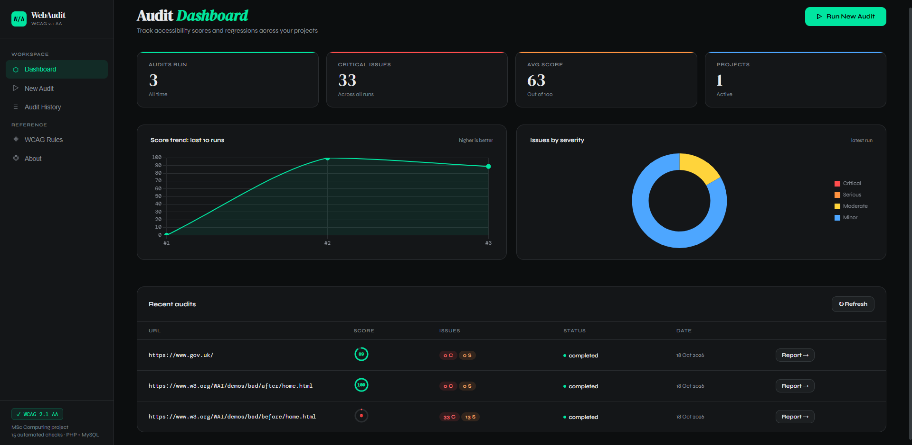
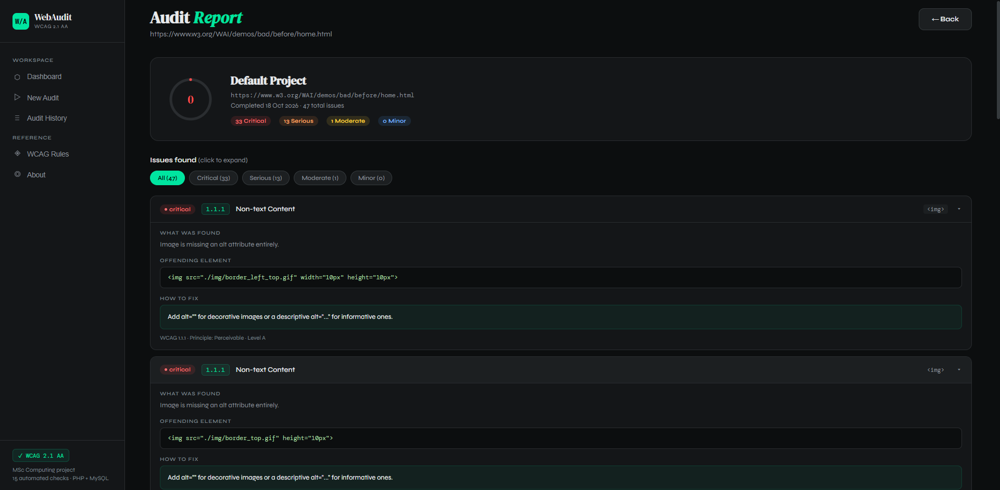

# WebAudit

An accessibility auditing tool that checks a web page against **WCAG 2.1 Level AA**, explains every issue with a suggested fix, and tracks each page's score over time.

I built WebAudit during my MSc Computing at the University of Sunderland. It later became the basis of my dissertation research into how accessibility reports should be presented so that developers actually fix the problems.

## What it does

- **Audits a page.** Enter a public URL and WebAudit fetches the HTML, parses it and runs 15 automated WCAG 2.1 AA checks.
- **Explains each issue.** Every finding shows the WCAG rule, a severity (critical, serious, moderate or minor), the offending HTML and how to fix it.
- **Scores the page out of 100.** Critical issues cost 20 points, serious 10, moderate 5 and minor 2. Each rule can deduct at most three times its weight, so one repeated mistake cannot wipe out the whole score.
- **Tracks progress.** Every run is stored in MySQL, so you can see whether a page's score improves after fixes.

## Checks included

| WCAG   | Rule                   | What is checked                                              |
| ------ | ---------------------- | ------------------------------------------------------------ |
| 1.1.1  | Non-text Content       | Images missing alt text; unusually long alt text             |
| 1.3.1  | Info and Relationships | Unlabelled form inputs; tables without header cells          |
| 1.3.2  | Meaningful Sequence    | Positive `tabindex` values that break focus order            |
| 1.4.3  | Contrast (Minimum)     | Heuristic check of inline styles (white on white, tiny text) |
| 1.4.4  | Resize Text            | Fixed `px` font sizes in inline styles                       |
| 1.4.10 | Reflow                 | Viewport settings that block zoom                            |
| 2.1.1  | Keyboard               | Clickable `div`/`span` elements with no keyboard access      |
| 2.4.1  | Bypass Blocks          | No skip-to-content link                                      |
| 2.4.2  | Page Titled            | Missing or empty `<title>`                                   |
| 2.4.4  | Link Purpose           | Generic link text such as "click here"                       |
| 2.4.6  | Headings and Labels    | Empty or duplicate headings                                  |
| 2.4.7  | Focus Visible          | `outline: none` in inline styles                             |
| 3.1.1  | Language of Page       | Missing `lang` attribute                                     |
| 3.3.1  | Error Identification   | Required inputs not linked to an error message               |
| 4.1.2  | Name, Role, Value      | Buttons without accessible names; invalid ARIA roles         |

## Tech stack

- **Back end:** PHP 8.2, object-oriented (`AuditEngine` class), PDO with prepared statements
- **Database:** MySQL, six tables with foreign keys (users, projects, audit runs, issues, WCAG rules, score trends)
- **Crawler:** cURL with `DOMDocument` and `DOMXPath`
- **Front end:** HTML, CSS and vanilla JavaScript, with Chart.js for the charts
- **API:** a small JSON API (`php/api.php`) with routes for audits, reports, history, trends and rules

## Security

WebAudit fetches whatever address a user types, so it is protected against **server-side request forgery (SSRF)**, one of the OWASP Top 10 risks:

- Only `http` and `https` on ports 80 and 443 are allowed, so addresses like `file:///etc/passwd` are refused.
- The host name is resolved first, and private, loopback and reserved addresses (such as `localhost`, `192.168.x.x` and `169.254.x.x`) are refused.
- Redirects are followed manually, at most three, and every new address goes through the same check.
- TLS certificates are verified, and requests time out after 15 seconds.
- Every database query that uses input runs as a prepared statement.
- Database credentials live in `php/db.php`, which is excluded from Git.

## Running it locally

1. Install [XAMPP](https://www.apachefriends.org/) (PHP 8.2+ and MySQL) and start Apache and MySQL.
2. Clone this repository into `xampp/htdocs/webaudit`.
3. In phpMyAdmin, import `database/schema.sql`. This creates the `webaudit_pro` database, the WCAG rules, a demo user and a default project.
4. Copy `php/db.example.php` to `php/db.php` and enter your database username and password (on XAMPP the default is `root` with no password).
5. Open `http://localhost/webaudit/` and run an audit. The W3C's deliberately inaccessible demo page is a good first test: `https://www.w3.org/WAI/demos/bad/before/home.html`

## Limitations

- **JavaScript-heavy sites.** WebAudit reads the HTML the server sends and does not run JavaScript, so single-page apps built with React or Vue are only partly audited.
- **Contrast is a heuristic.** Accurate contrast checking needs a real browser to calculate final colours; WebAudit only inspects inline styles.
- **Automated checks are a starting point.** Automated tools catch only part of all accessibility problems. Manual testing with a keyboard and a screen reader is still needed.

## Planned improvements

- Group repeated issues (for example, "1.1.1 Non-text Content: 33 images") into one expandable card
- Warn when a page appears to be a JavaScript app, instead of showing a misleading high score
- Rate limiting for the public audit endpoint
- Automated tests for the audit checks

## Author

**Ojo Ifeanyi Ukiwe**: [GitHub](https://github.com/ifeanyiukiwe) · [LinkedIn](https://www.linkedin.com/in/ifeanyiukiwe)
